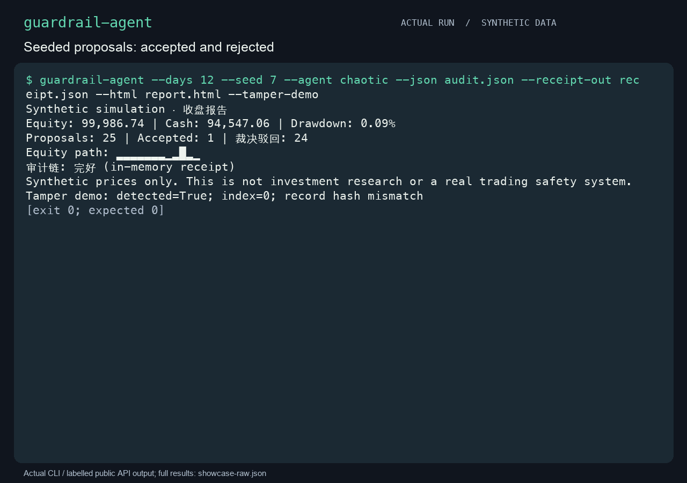

<p align="center"><strong>English</strong> &nbsp;·&nbsp; <a href="README.zh-CN.md">简体中文</a></p>

<p align="center"></p>
<h1 align="center">guardrail-agent</h1>
<p align="center"><strong>Watch a rule become an execution decision.</strong></p>
<p align="center">An offline teaching simulator: propose, evaluate, recheck at execution, and inspect an audit receipt. All prices and orders are synthetic.</p>
<p align="center"><a href="#quick-start">Quick start</a> &nbsp;·&nbsp; <a href="#usage">Usage</a> &nbsp;·&nbsp; <a href="docs/guide.md">Guide</a> &nbsp;·&nbsp; <a href="CONTRIBUTING.md">Contribute</a></p>

<p align="center"><a href="assets/demo.gif" title="Open the full-size usage demonstration"></a></p>

Synthetic proposals, actual simulated fills, and receipt-based rejection of an altered audit. [Recording and reproduction](assets/MEDIA.md).

## Why guardrail-agent?

A proposal can pass a gate and still become stale before execution. The simulated executor binds the decision to the proposal, configuration, market, and portfolio, then rechecks that state. A separately held receipt lets you inspect whether an exported audit matches the original run.

## Quick start

Python 3.11+ on macOS or Linux. The demo verifies an intact audit and then expects rejection after removing a record. No brokerage or live-market connection exists.

```bash
python3 -m venv .venv
.venv/bin/python -m pip install .
.venv/bin/python scripts/demo.py
```

## Usage

### Run a synthetic scenario

```bash
guardrail-agent --days 30 --seed 7 --agent chaotic
guardrail-agent --days 30 --json audit.json --html report.html --receipt-out receipt.json
guardrail-agent --verify audit.json --receipt receipt.json
```

Activate `.venv` first. `momentum` and `chaotic` are demonstration proposers. Choose a private output directory; JSON exports and verification inputs are limited to 20 MB.

Keep the receipt independently. If someone can rewrite both the audit and its reference, a hash chain cannot establish authenticity. Exit `0` means the operation completed, `1` means verification failed, and `2` means an input or I/O error.

## Scope

This is a single-threaded educational simulation with illustrative accounting, not a strategy backtest, real-world risk policy, signature, or compliance attestation. The guide explains fills, fees, reducing sells, replay checks, and the exact receipt trust model.

See the [usage guide](docs/guide.md) for more examples, exact parameters, and technical boundaries.

## Contributing

Start with [CONTRIBUTING.md](CONTRIBUTING.md). Use synthetic reproductions and report the validation you actually ran.

[MIT License](LICENSE) · [简体中文](README.zh-CN.md)
