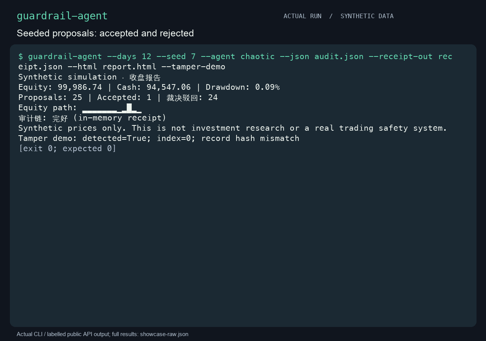

<p align="center"><a href="README.md">English</a> &nbsp;·&nbsp; <strong>简体中文</strong></p>

<p align="center"></p>
<h1 align="center">guardrail-agent</h1>
<p align="center"><strong>从一个提议，看规则如何落地。</strong></p>
<p align="center">一个离线教学模拟器：提出意向、评估规则、执行前重核，再检查审计收据。行情与订单均为合成数据。</p>
<p align="center"><a href="#快速开始">快速开始</a> &nbsp;·&nbsp; <a href="#实际使用">使用方式</a> &nbsp;·&nbsp; <a href="docs/guide.zh-CN.md">完整手册</a> &nbsp;·&nbsp; <a href="CONTRIBUTING.md">参与贡献</a></p>

<p align="center"><a href="assets/demo.gif" title="点击查看原尺寸演示"></a></p>

合成提议、实际模拟成交，以及审计被改动后的收据验证。 [录制与复现](assets/MEDIA.md)。

## 为什么需要它

提议通过门禁之后，状态仍可能变化。模拟执行器将决策绑定提案、配置、行情与组合，再在执行时重核。独立保留的收据，则用于比较导出审计是否仍与原运行对应。

## 快速开始

需要 macOS / Linux 与 Python 3.11+。演示先验证完整审计，再删去记录并核对预期拒绝；不连接券商或真实市场。

克隆已发布源码，在独立环境中安装：

```bash
git clone --branch noah/guardrail-agent https://github.com/LucasXlab/guardrail-agent.git
cd guardrail-agent
python3 -m venv .venv
. .venv/bin/activate
python -m pip install .
python scripts/demo.py
```

适合教学与原型讨论：观察“提案被批准”和“实际执行”之间为什么还需要复检。演示会创建合成记录、验证完整记录，再检查删除一条记录后会被拒绝。要得到可打开的独立报告：

```bash
mkdir synthetic-run
guardrail-agent --days 30 --seed 7 --agent chaotic \
  --json synthetic-run/audit.json --html synthetic-run/report.html \
  --receipt-out synthetic-run/receipt.json
guardrail-agent --verify synthetic-run/audit.json --receipt synthetic-run/receipt.json
```

打开 `synthetic-run/report.html`，对照 JSON 查看获批和被拒的提案。验证应返回 `ok: true`。复现时固定 seed、提案器和天数；每次用新输出目录，模拟导出可能覆盖已有普通文件。要检测后续改动，须先把回执副本保存到独立可信位置。CLI 与 HTML 报告目前使用英文；本项目定位是教学模拟器。

## 实际使用

### 运行一个合成场景

```bash
guardrail-agent --days 30 --seed 7 --agent chaotic
guardrail-agent --days 30 --json audit.json --html report.html --receipt-out receipt.json
guardrail-agent --verify audit.json --receipt receipt.json
```

`momentum` 与 `chaotic` 是示范提议方。使用私有输出目录；JSON 导出和验证输入上限为 20 MB。

收据需要独立保管。若审计与参照可被同时改写，哈希链无法证明真实性。退出 `0` 表示操作完成，`1` 表示验证失败，`2` 表示输入或 I/O 错误。

## 适用边界

这是单线程教学模拟，浮点核算只作说明；不能当作策略回测、实盘风控、签名或合规证明。成交、费用、减仓卖出、重放检查及收据信任模型，均在手册中说明。

详细参数、更多演示和技术边界见[中文使用手册](docs/guide.zh-CN.md)。

## 参与贡献

请从[贡献指南](CONTRIBUTING.md)开始，使用合成输入复现问题，并报告实际执行的验证。

[MIT 许可证](LICENSE) · [English](README.md)
