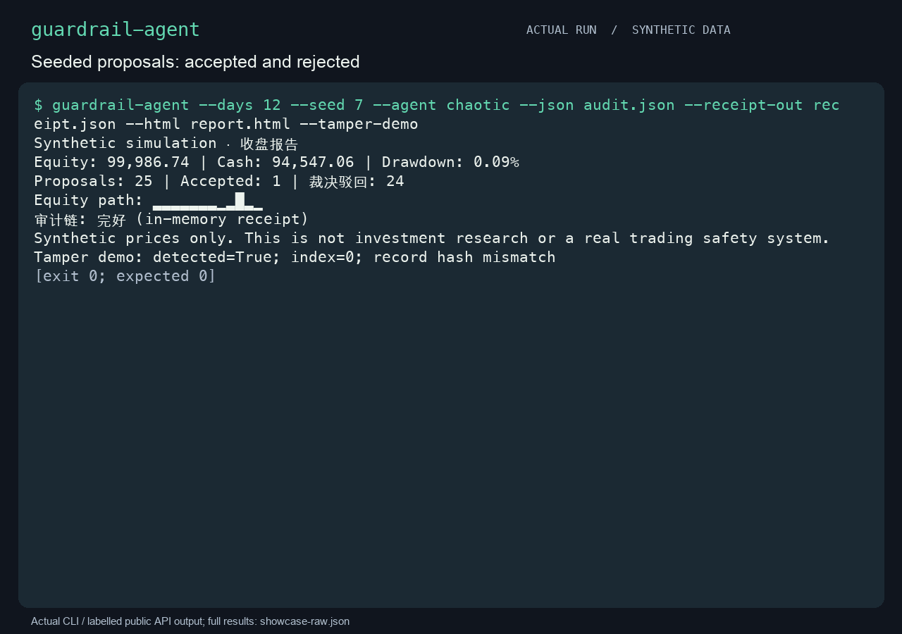
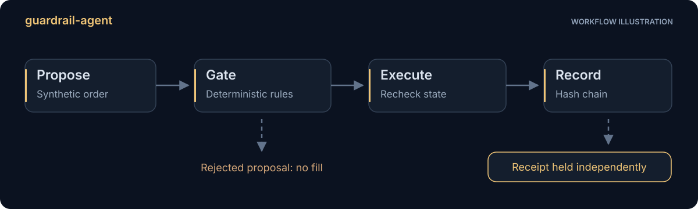
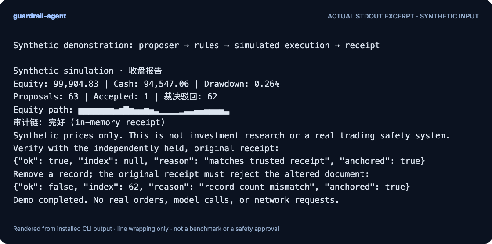
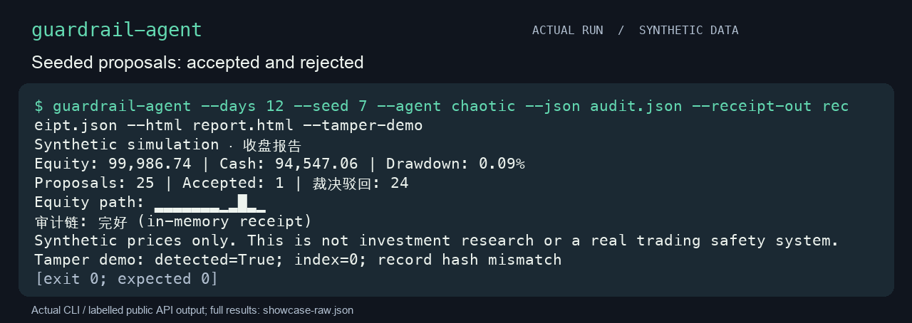
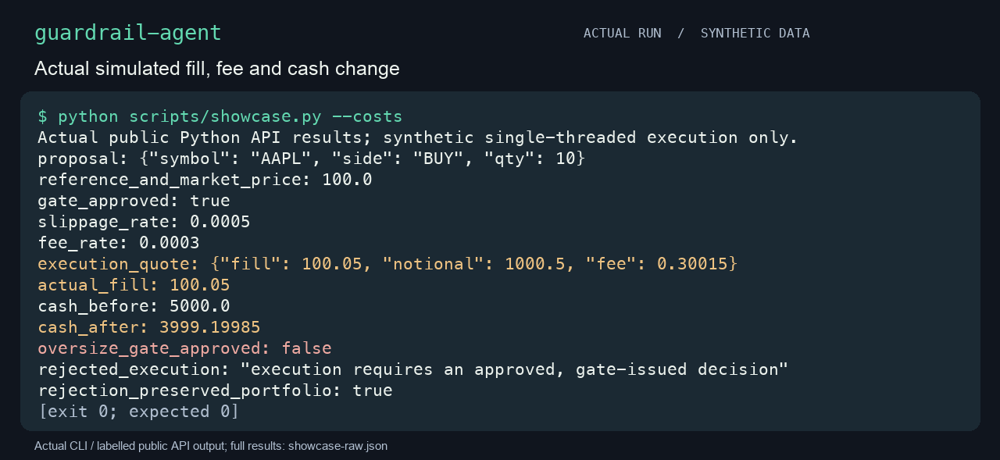
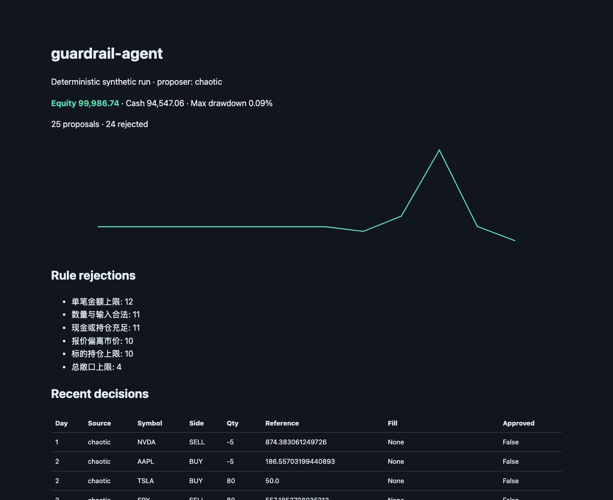
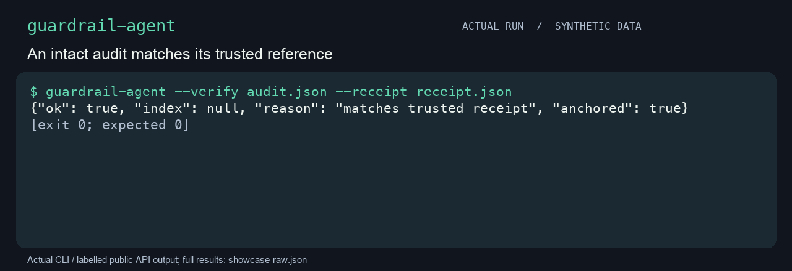
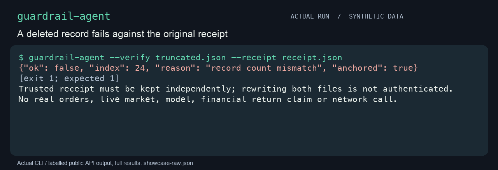
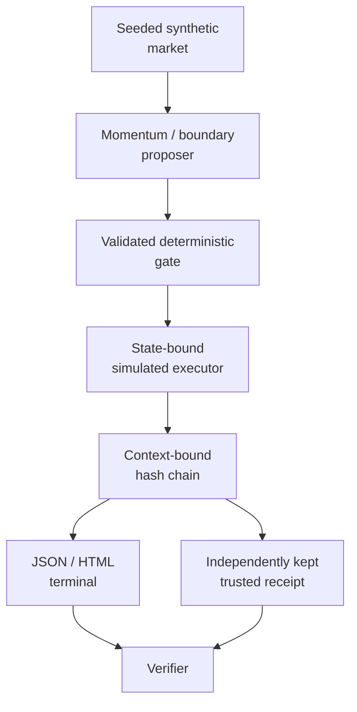

**English** · [简体中文](guide.zh-CN.md)

<p align="center"></p>
<h1 align="center">guardrail-agent</h1>
<p align="center"><strong>See a proposal checked, executed, and checked again.</strong></p>

An offline teaching simulator for deterministic proposal gates. A proposer suggests an order, rules evaluate it, a state-bound simulated executor rechecks it, and a hash chain records the decision. All market data is seeded and synthetic.

[简体中文](../README.zh-CN.md) · [Quick start](#quick-start) · [Follow a run](#follow-one-run) · [Receipt trust](#audit-receipts-and-their-limits) · [Mechanisms](#exact-simulation-contract) · [MIT](../LICENSE)



The GIF renders a real local recording: three installed CLI calls and an explicitly labelled public Python API example. Reading holds replace execution timing. [Full outputs, artifacts, cast and authoring](../assets/MEDIA.md) remain available.

## What happens after a proposal passes?

A gate's decision can become stale when the portfolio or price changes. This simulator binds a decision to the proposal, configuration, market, and portfolio, then checks that context again at execution. You can inspect rejected proposals and verify the exported record against a separately held receipt.

Use it to understand control flow and audit trust. It is a single-threaded educational simulation with illustrative accounting, not a live-market integration or a strategy backtest.

## Why inspect the whole path?

| Start with | What it makes visible | What it cannot establish |
|---|---|---|
| A proposal log | What was requested | Whether execution used the same state or included costs |
| A self-contained hash chain | Internal order and content consistency | Authenticity when both history and its reference can be rewritten |
| This simulator | Deterministic gate decisions, rechecked execution and comparison with a supplied trusted receipt | Real-world policy adequacy, financial returns, signatures or identity |

These are mechanism comparisons, not measured security or performance advantages.



## Quick start

From this source checkout, with Python 3.11+ on macOS or Linux:

```sh
python3 -m venv .venv
.venv/bin/python -m pip install .
.venv/bin/python scripts/demo.py
```

The demo runs the real installed CLI, checks a clean audit against its receipt,
then confirms a truncated audit is rejected. Installation may download build
tools. Simulation and verification have no third-party runtime dependencies or
network calls. No package-registry release or remote CI result is claimed.

<details>
<summary>See actual CLI output</summary>



Rendered from a real stdout excerpt, not invented output. A JSON excerpt may be incomplete. [Text excerpt](../assets/readme-demo.txt) · [Reproduce](../docs/readme-demo.md).

</details>

## Follow one run

| Step | Observe | Why it matters |
|---|---|---|
| Propose | `--agent chaotic` in the disposable demo | Boundary proposals make rejection paths visible |
| Evaluate and execute | Rule results and simulated fills | A gate decision is rechecked against current state |
| Keep the receipt | Original count, head hash, and context digest | The verifier needs an independently trusted reference |
| Alter a copied audit | The demo removes a record and expects exit `1` | A changed log is detected against the original receipt |

The demo verifies both the intact and altered records. The receipt must remain outside an attacker's ability to rewrite the audit and its reference together.



### Inspect costs and the execution check

The showcase's actual public API example uses a synthetic market price of 100 and 10 units. The shared quote produces a 100.05 fill and a 0.30015 fee; cash moves from 5000 to 3999.19985. A rejected oversize proposal cannot execute through the same Broker entry, and the portfolio stays unchanged. These are controlled accounting examples, not returns.



### Open the generated report

The CLI's standalone HTML shows the seeded run's proposals, rule rejections and recent decisions. This is the actual report's top viewport; the [complete generated HTML](../assets/synthetic-report.html) is included. Its equity line describes one synthetic path, not strategy performance.



## Run and inspect

Activate `.venv` first, or use `.venv/bin/guardrail-agent`:

```sh
guardrail-agent --days 60 --seed 42 --agent momentum
guardrail-agent --days 30 --seed 7 --agent chaotic --verbose
guardrail-agent --days 30 --json audit.json --html report.html --receipt-out receipt.json
guardrail-agent --verify audit.json --receipt receipt.json
```

Use `.venv/bin/guardrail-agent` when the virtual environment is not activated.
`python -m guardrail_agent` and the source compatibility script
`python guardrail_agent.py` expose the same CLI. Days must be between 1 and 10,000.
JSON exports and verification inputs are limited to 20 MB; use shorter runs if an export exceeds that bound.
Exit 0 means the requested operation succeeded; exit 1 means receipt verification
failed; exit 2 means an input, configuration, or I/O error.

## Exact simulation contract

- A proposal's price is a **reference quote**, not a limit order. Its two-sided
  deviation from the current synthetic market is checked.
- The gate and executor share the same market-plus-slippage fill and fee model.
  Actual execution notional is used for order limits and cash checks.
- Execution rechecks rules and binds the decision to the current configuration,
  prices, proposal, and portfolio. Rejected, manually fabricated, stale, or
  replayed decisions cannot modify the portfolio through `Broker.execute`.
  This is an in-process consistency check, not an authentication boundary against
  an attacker who can alter Python memory. Execution is single-threaded; concurrent
  portfolio mutation or simultaneous executors are outside this simulator's contract.
- Quantities are positive integers, never booleans or silently truncated floats.
  Prices, fees, balances, and valuations must be finite. A nonzero holding with no
  current or last-known price is an error; a sell also requires its cost basis.
- A valid sell that only reduces an existing long position bypasses opening-order
  minimum size, daily count, cooldown, position-value and exposure caps. It still
  checks symbol, quantity, two-sided quote deviation, no short selling, and the
  maximum execution notional. A large sell may need to be split to meet that cap.
- Invalid input stops evaluation: unevaluated rule records have `pass: null`, not
  a fabricated pass or failure. The input-validation rule records the rejection.

These are educational rules for this simulator, not a real trading risk policy.
The market generator and proposer are demonstrations, not strategy backtests or
investment recommendations. Floating-point accounting is illustrative.

## Audit receipts and their limits

Each SHA-256 record covers its schema, sequence, payload, previous hash, and a
digest of the run context (configuration, seed, days, proposer). JSON rejects
non-finite numbers. Verification checks record order, count, head, and context.

Keep a trusted receipt **independently** from the audit document. The CLI requires
`--receipt` for verification. If an attacker can rewrite both files, the hash
chain cannot prove authenticity. A receipt is not a signature, trusted timestamp,
identity assertion, or compliance attestation. The library can check a document
without a receipt, but labels that result as internal consistency only.



Removing the last record from a copied audit returns exit 1 against that original receipt. `anchored: true` means a reference was supplied; its independent trust is assumed, not authenticated by the program.



The original chain instance also retains an in-memory count/head receipt. The
`--tamper-demo` flag changes a copied record and demonstrates detection without
damaging exported files.

## Architecture



## Development

```sh
make dev
make check
make demo
```

`make check` runs lint, formatting checks, the full test suite with a 70% package
coverage threshold, and sdist/wheel builds. `PYTHON` and `VENV` can select a local
interpreter and virtual-environment directory. CI is prepared for Python 3.11 and
3.13; repository hosting and remote CI execution are separate publishing steps.

## Privacy, compatibility, and limits

No API keys are needed. `.env` is not read. The previous optional model adapter
has been removed; `--agent llm` and `--llm` are unsupported. No brokerage or live
market integration exists. All bundled demonstration data is synthetic.

Reports contain the proposals and context you supply. Review exports before
sharing them. Secure verification-file reading requires POSIX no-follow support;
macOS and Linux are the supported targets. Explicit output paths are user-chosen;
symlink targets are rejected and each file is replaced atomically after staging.
Writing several files is not a cross-file transaction, and concurrent directory
changes or a failed later rename are not rolled back. Use a private directory.

Tests cover the simulator's stated mechanisms, not the adequacy of a real-world
financial policy. There are no accuracy, profitability, or attack-proof claims.

## Roadmap

- Documented alternative teaching-policy contracts.
- More visual explanations of independent receipt trust.
- Clearer localization of rule descriptions.

No live-execution or profitability claim is implied by this roadmap.

## Contributing

Read [CONTRIBUTING.md](../CONTRIBUTING.md). Development used AI assistance. Bring reproducible synthetic inputs and keep the default offline. Do not publish private portfolio data or treat this simulator as a real trading risk system.

## License

[MIT](../LICENSE).
