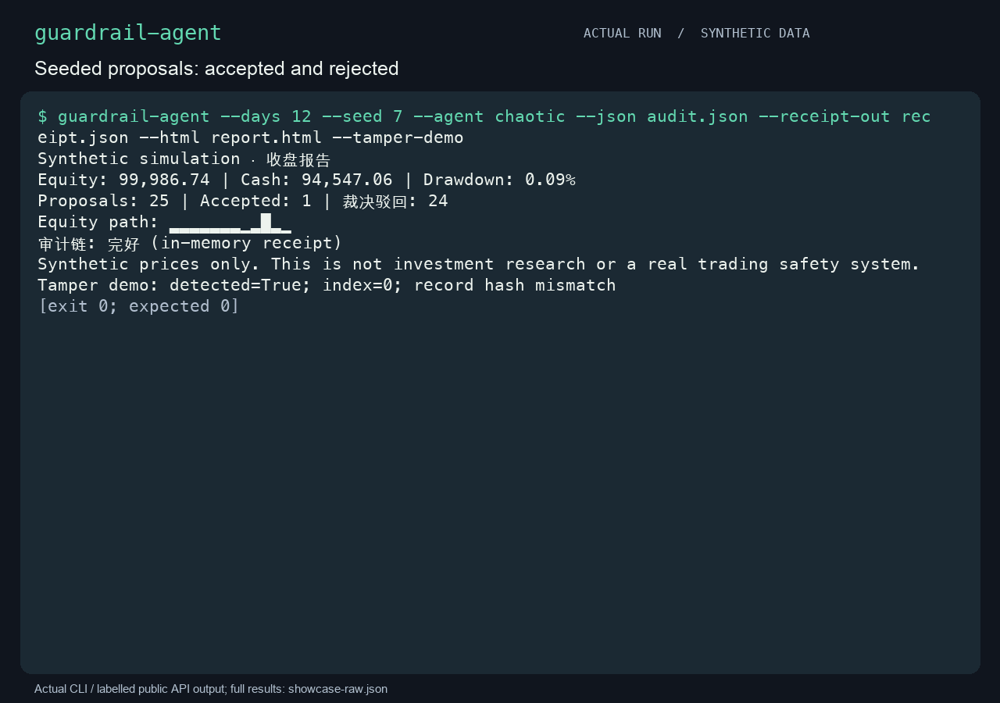
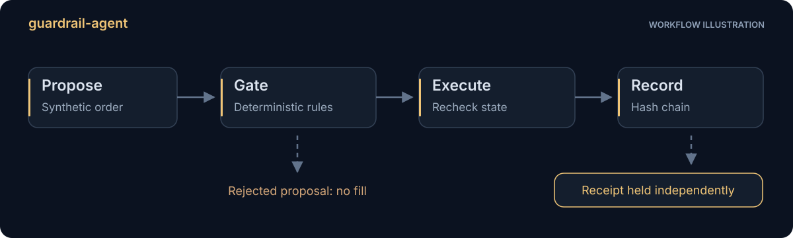
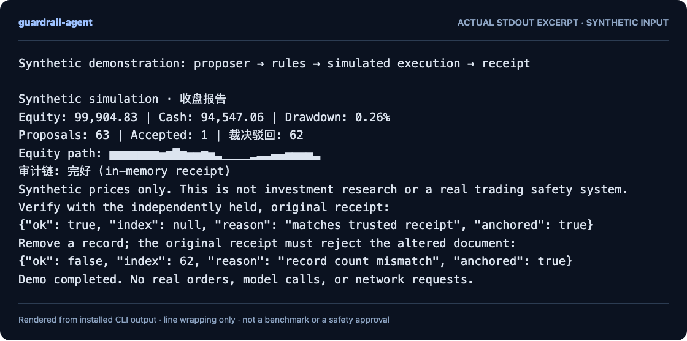
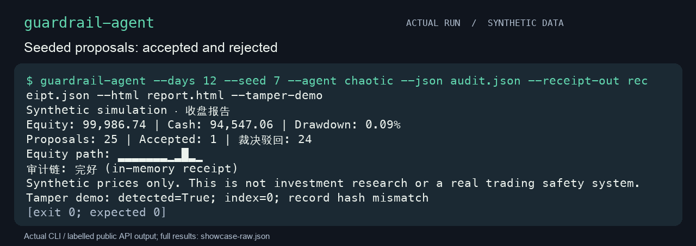
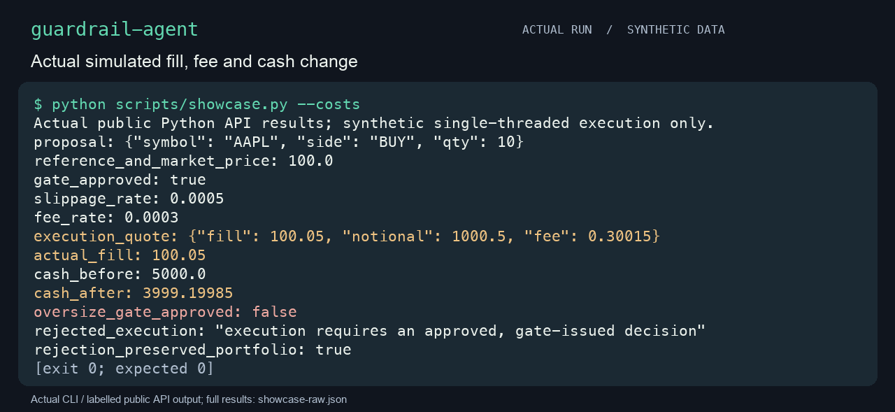
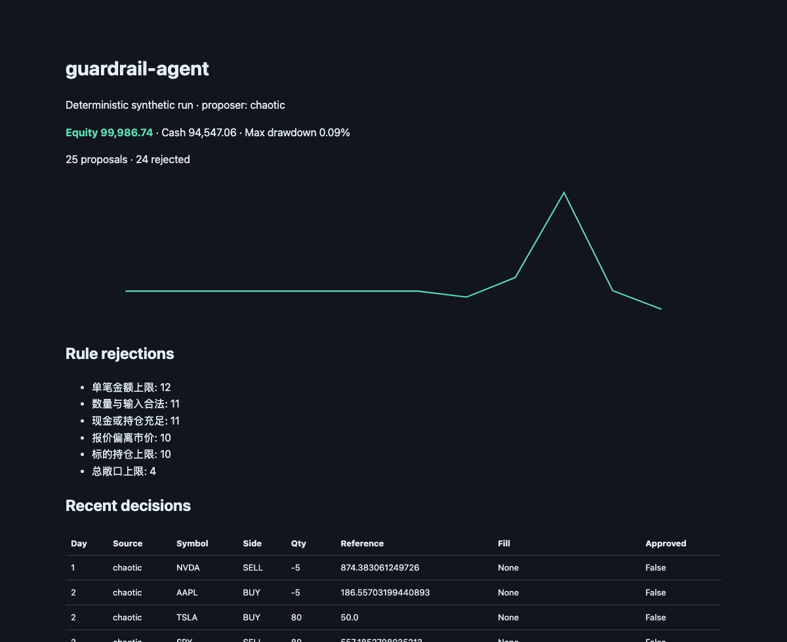
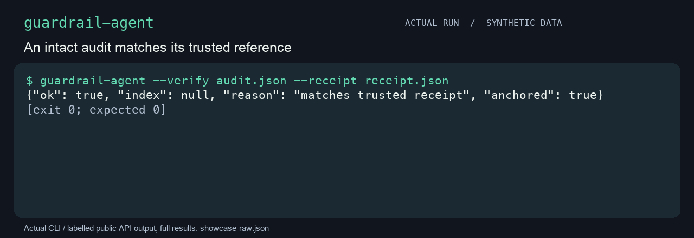
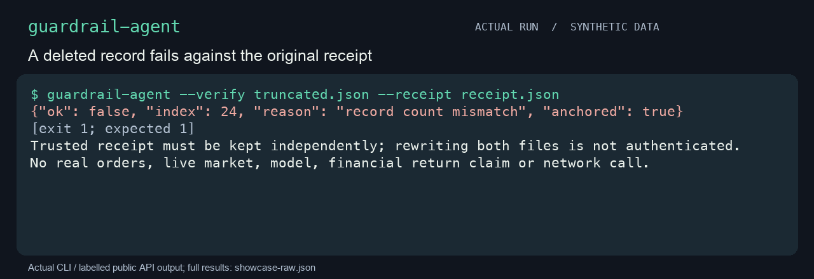
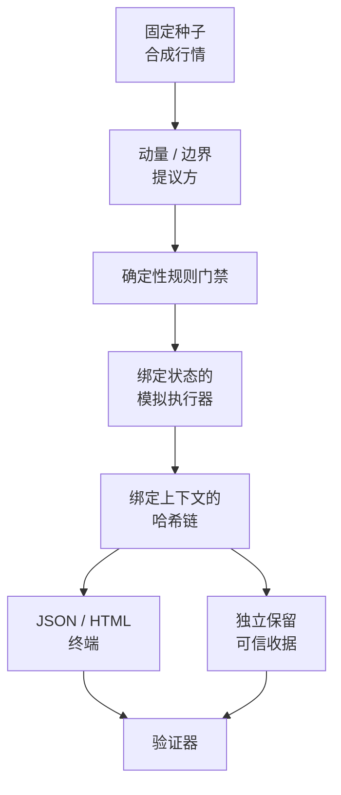

[English](guide.md) · **简体中文**

<p align="center"></p>
<h1 align="center">guardrail-agent</h1>
<p align="center"><strong>看一个提议如何被检查、执行，再次核对。</strong></p>

用于理解确定性提议门禁的离线教学模拟器：提议方提出意向，规则评估，绑定状态的模拟执行器再次核对，哈希链记录裁决。所有行情均由固定种子生成。

[English](../README.md) · [快速开始](#快速开始) · [跟随一次运行](#跟随一次运行) · [收据信任](#哈希链与收据) · [MIT](../LICENSE)



GIF 来自真实本地录制：三次已安装 CLI 调用，以及明确标注的公开 Python API 示例。阅读停留与实际运行时间不同。[完整输出、生成物、cast 与复现](../assets/MEDIA.md) 可核对。

## 提议通过之后，还需要什么

组合或价格变化，可能使早先的门禁判断过期。模拟器把决策与提案、配置、行情和组合绑定，并在执行时重新核对。你可以检查拒绝记录，也可以用独立保留的收据验证导出审计。

适合学习控制流与审计信任。它是单线程教学模拟，浮点核算仅作说明，不接实盘，也不是策略回测。

## 为什么看完整路径？

| 起点 | 能看见什么 | 不能据此确认什么 |
|---|---|---|
| 提案日志 | 请求了什么 | 执行是否使用同一状态、是否计算成本 |
| 自含哈希链 | 顺序与内容的内部一致性 | 日志和参照同时被改写后的真实性 |
| 本模拟器 | 确定性规则、执行重检、对给定可信收据的比较 | 实盘策略适用性、收益、签名或身份 |

这是机制比较，没有测量安全或性能优势。



## 快速开始

从当前源码目录运行，需要 macOS/Linux 与 Python 3.11+：

```sh
python3 -m venv .venv
.venv/bin/python -m pip install .
.venv/bin/python scripts/demo.py
```

演示调用实际安装的CLI，先用独立保留的原收据验证完整审计，再删掉一条记录确认验证失败。
安装可能下载构建工具，运行时只使用标准库。不暗示已经在包注册表发行或通过远端CI。

<details>
<summary>查看真实 CLI 输出节选</summary>



图像由真实 stdout 节选排版生成，不是虚构输出。JSON 节选可能不完整。[文本节选](../assets/readme-demo.txt) · [复现方式](../docs/readme-demo.md)。

</details>

## 跟随一次运行

| 步骤 | 观察什么 | 为什么需要 |
|---|---|---|
| 提议 | 演示使用 `--agent chaotic` | 边界提议让拒绝路径可见 |
| 评估与执行 | 规则结果和模拟成交 | 再核对当前状态是否仍与决策相符 |
| 保留收据 | 数量、头摘要与运行上下文摘要 | 验证者需要独立可信的参照 |
| 修改审计副本 | 演示删掉记录，预期退出 `1` | 与原收据比较，可发现记录被改动 |

若攻击者能同时重写审计和收据，验证失去可信参照。演示分别核对完整记录和修改后的记录。



### 检查成本与执行重检

showcase 的实际公开 API 示例使用市价100、数量10的合成输入。统一报价产生100.05的模拟成交价、0.30015费用，现金从5000变为3999.19985。超额提案被拒绝后，无法通过同一 Broker 入口成交，组合保持不变。此为受控核算示例，不是收益表现。



### 打开实际报告

CLI 的独立 HTML 展示合成提案、规则拒绝和近期决策。这里是报告顶部的真实浏览器截图；[完整 HTML](../assets/synthetic-report.html) 可查看。权益曲线只描述单次合成路径，不是策略表现。



## 使用

```sh
.venv/bin/guardrail-agent --days 60 --seed 42 --agent momentum
.venv/bin/guardrail-agent --days 30 --agent chaotic --json audit.json --html report.html --receipt-out receipt.json
.venv/bin/guardrail-agent --verify audit.json --receipt receipt.json
```

天数范围为1–10000，JSON导出与验证输入限20MB；超限时应缩短运行。`--tamper-demo`只篡改副本。退出码0表示操作成功，1表示审计验证失败，2表示参数或I/O错误。

## 明确的机制边界

- 提案价格是参考报价，不是限价单；检查相对市价的双向偏离。闸门和执行器使用同一份滑点、费用与实际成交金额。
- 执行前重新检查规则，决策绑定提案、配置、行情和组合状态。拒绝、伪造、过期或重放决策不能通过执行入口改变组合；这不是对可任意修改Python内存的攻击者的认证系统。执行按单线程定义，不支持并发修改组合或同时执行多个撮合器。
- 数量必须为正整数且不能是布尔值，所有数值须有限。缺少持仓估值或卖出成本基础时拒绝处理，不静默按0计价。
- 严格减少已有多头的卖单豁免开仓用的最小金额、当日笔数、冷却、持仓和总敞口上限；仍保留标的、报价、整数数量、不可卖空和最大单笔成交金额检查。大额减仓可能需要拆单。
- 输入无效时，其余规则的`pass`为`null`，表示未评估，不冒充已通过或已触发。

这些是教学模拟规则，不能外推为实盘风控或策略表现。浮点核算只作说明。

## 哈希链与收据

记录摘要覆盖schema、序号、payload、前序hash和运行配置摘要；验证顺序、数量、头hash及上下文。
可信收据必须独立保管。如果审计与收据都能被同时重写，哈希链不能证明真实性。
它不是签名、可信时间戳、身份认证或合规证明。库API不带收据时只声称内部一致性。



删除审计副本末条后，对同一原收据验证返回退出码1。`anchored: true` 只表示给了参照，其独立可信性是前提，不是程序认证的结果。



## 架构



此图解释数据流，不表示实盘、认证或安全保证。

## 开发与局限

`make dev`建立开发环境，`make check`执行lint、格式、全套测试/70%包覆盖门槛和构建，`make demo`运行合成演示。
CI配置了Python 3.11/3.13矩阵，当前结果请查看仓库Actions。原可选模型适配器已移除，`--llm`及`--agent llm`不再支持。

不读取`.env`，无需密钥；导出物包含调用者提供的提案和配置，分享前应检查。
输入JSON以POSIX不跟随链接方式读取，输出拒绝符号链接目标，先准备文件再逐个原子替换。
多文件输出不是整体事务，不保证并发目录替换或后续rename失败时全部回滚，建议使用私有目录。

完整契约见[英文 README](../README.md)。

## 路线计划

- 明确记录其它教学策略契约。
- 更直观解释独立收据信任。
- 改善规则说明的本地化。

路线不代表计划或保证实盘执行及盈利。

## 参与贡献

请读[贡献说明](../CONTRIBUTING.md)。开发使用 AI 辅助。请提供可复现的合成输入，保持默认离线，不公开私人组合数据，也不把教学模拟当作实盘风控。

## 许可

[MIT](../LICENSE)。
